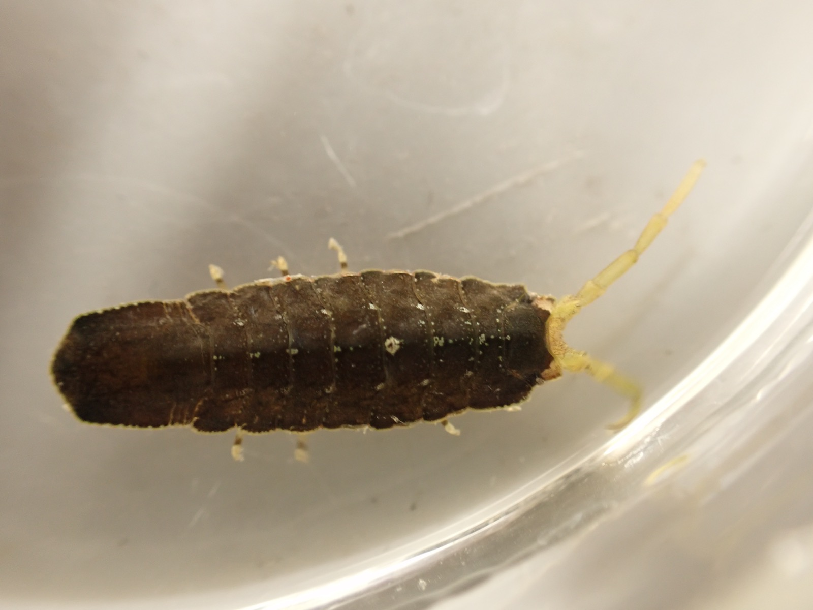
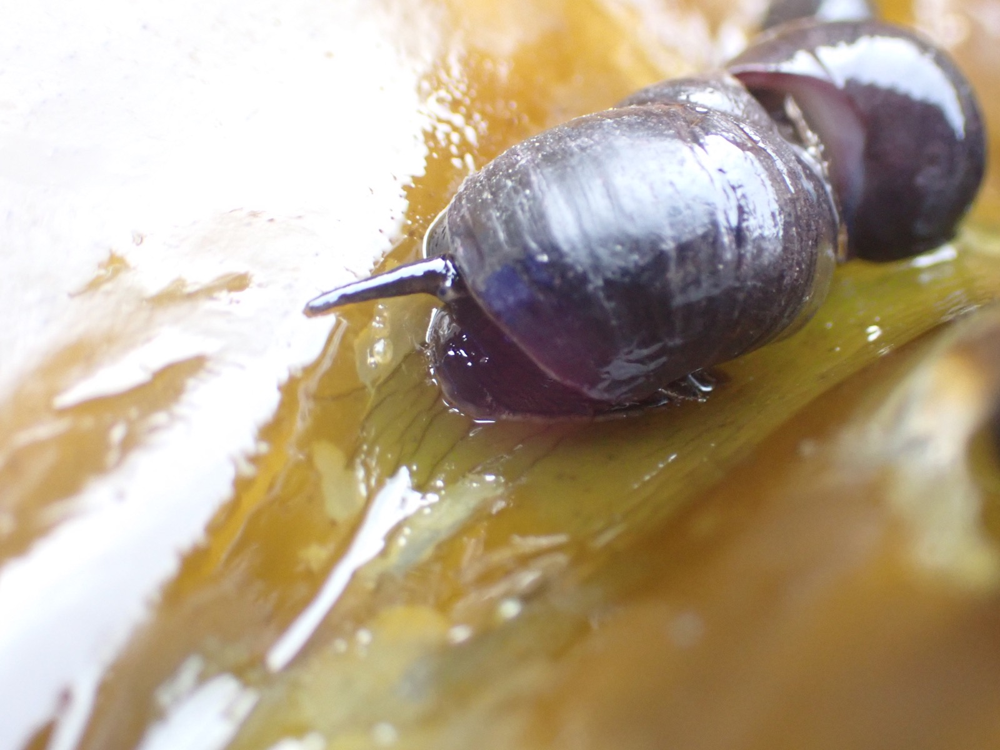
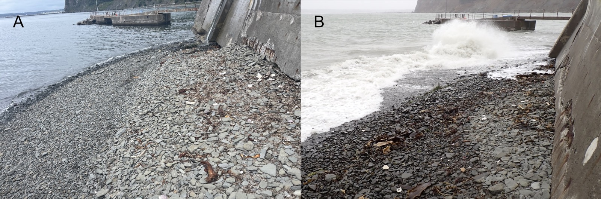
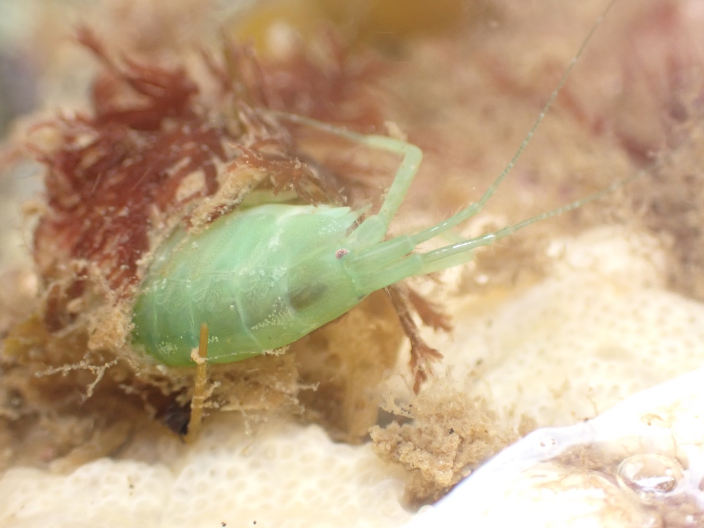
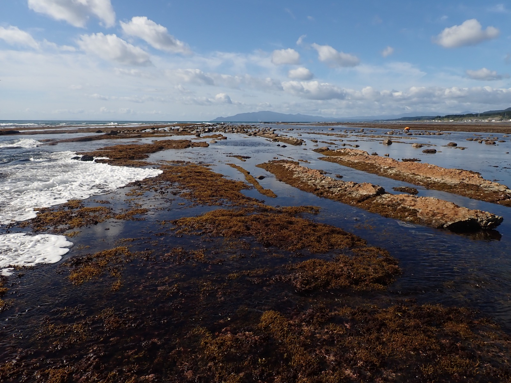

以下に挙げる複数の領域とその複合領域に興味があります．

::: {.grid}

::: {.g-col-12 .g-col-md-6}
{.img-fluid}

### 捕食者ー被食者相互作用

:::

::: {.g-col-12 .g-col-md-6}
{.img-fluid}

### 植物ー草食者相互作用

:::

::: {.g-col-12 .g-col-md-6}
{.img-fluid}

### 激しい気象イベントの進化・生態的帰結

:::

::: {.g-col-12 .g-col-md-6}
{.img-fluid}

### 人間活動が生物間相互作用に及ぼす影響

:::

::: {.g-col-12}
{.img-fluid}

### 科学的自然史

:::

:::

Latest update - `r format(Sys.time(), " %Y/%m/%d")`
